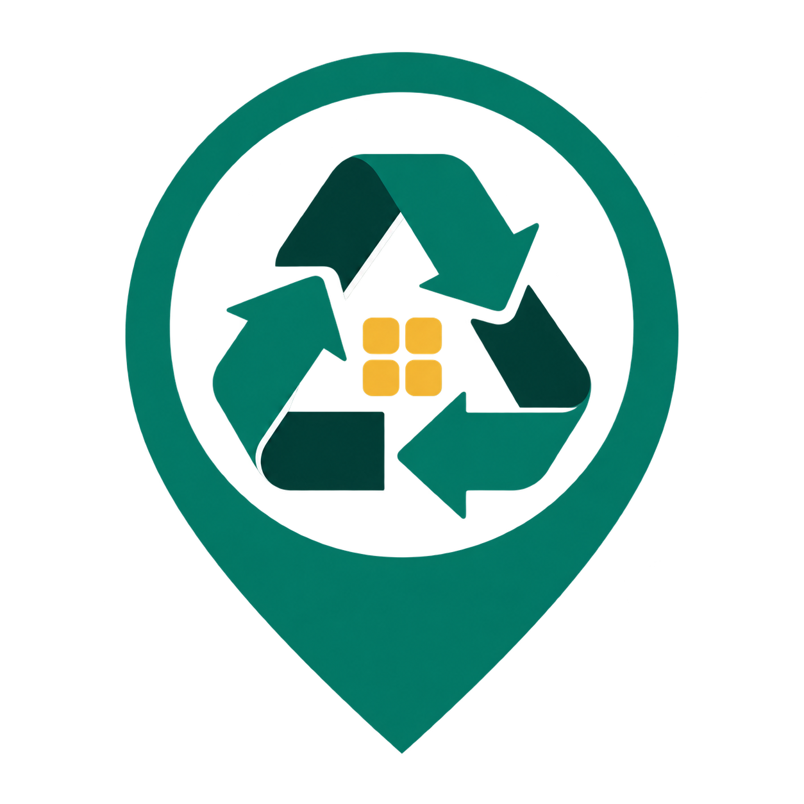
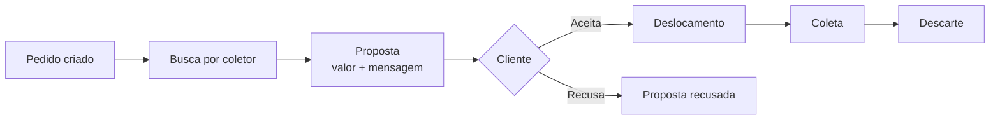
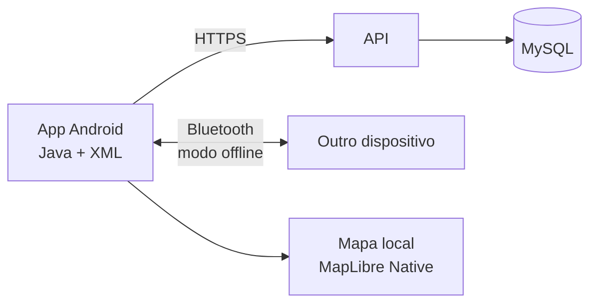

# Coletaí
<div align="center">




**Juntos por uma sociedade mais saudável.**<br>
Aplicativo Android que conecta quem precisa descartar resíduos a ambulantes e empresas que fazem a coleta. Um "delivery reverso" para pilhas, baterias, eletrônicos, seringas, óleo e mais.

<br>


<br><br>

[Sobre](#-sobre) · [Funcionalidades](#-funcionalidades) · [Como funciona](#-como-funciona) · [Como rodar](#-como-rodar) · [Documentação](#-documentação) · [Colaboradores](#-colaboradores)

<br>


</div>

<br>

## 🌱 Sobre

Muita gente quer descartar certos resíduos do jeito certo, mas não sabe onde levar nem quem pode buscar. O Coletaí resolve isso com logística reversa: o cliente pede a coleta e um coletor, que pode ser ambulante ou empresa, se oferece para buscar o material com uma proposta de valor.

> [!NOTE]
> O MVP Android (Java) foi apresentado no **6º WECTI da UNICID**. Na validação por QR code, o app recebeu **15 avaliações com nota 10**.

<br>

## ✨ Funcionalidades

| 📦 Pedidos | 🤝 Propostas | 📍 Mapa e histórico |
|---|---|---|
| Criação e acompanhamento de pedidos de coleta | Envio de proposta com valor e mensagem, com aceite ou recusa pelo cliente | Mapa local com pontos de descarte e histórico de pedidos e coletas |

| 🚚 Etapas da coleta | 📡 Modo offline | 🛠️ Administração |
|---|---|---|
| Deslocamento, coleta e descarte acompanhados passo a passo | Comunicação entre dispositivos via Bluetooth para apresentar sem internet | Painel administrativo demonstrativo |

<br>

## 👥 Perfis

| Perfil | O que faz |
|---|---|
| **Cliente** | Cria o pedido, recebe propostas, aceita ou recusa e acompanha cada etapa |
| **Ambulante** | Busca pedidos, envia proposta com valor e mensagem e faz a coleta |
| **Empresa** | Atua como coletora, com o mesmo fluxo de propostas e coletas |
| **Administrador** | Acompanha a operação pelo painel administrativo demonstrativo |

<br>

## 🔄 Como funciona



Detalhes em [`docs/FLUXO_PEDIDOS.md`](docs/FLUXO_PEDIDOS.md).

### Arquitetura



Mais em [`docs/ARQUITETURA.md`](docs/ARQUITETURA.md), [`docs/MAPAS.md`](docs/MAPAS.md) e [`backend/README.md`](backend/README.md).

<br>

## 🧰 Tecnologias

| Tecnologia | Uso |
|---|---|
| **Java** | Linguagem do app Android |
| **XML** | Layouts das telas |
| **Android Studio** | IDE e build |
| **MapLibre Native** | Mapa local com pontos de descarte |
| **API HTTPS + MySQL** | Backend e banco de dados |
| **Bluetooth** | Comunicação offline entre dispositivos |
| **Git e GitHub** | Versionamento e colaboração |

<br>

## 📁 Estrutura do repositório

| Pasta ou arquivo | Conteúdo |
|---|---|
| [`app/`](app) | Código do app Android (Java e XML) |
| [`backend/`](backend) | API e banco de dados |
| [`docs/`](docs) | Documentação técnica e imagens do README (`docs/img/`) |
| [`gradle/`](gradle) | Arquivos do Gradle Wrapper |
| [`tools/`](tools) | Scripts Python: `build_disposal_catalog.py` (catálogo de descarte) e `build_offline_map.py` (mapa offline) |
| [`LICENSE`](LICENSE) | Licença do projeto |

<br>

## 🚀 Como rodar

**Pré-requisitos:** Android Studio com o SDK e o JDK indicados pelo Gradle, e um emulador ou celular Android.

```bash
git clone [PREENCHER: link do repositório]
```

1. Abra a **pasta raiz** do projeto no Android Studio e espere o Gradle sincronizar.
2. Configure o SDK local em `local.properties`.
3. Rode o app no emulador ou no celular.

Para a API e o banco, siga o [`backend/README.md`](backend/README.md).

### Verificações e APK debug

No PowerShell, na raiz do projeto:

```powershell
.\gradlew.bat testDebugUnitTest lintDebug assembleDebug assembleDebugAndroidTest
```

Roda os testes unitários e o lint, gera o APK debug e compila os testes instrumentados. O APK debug fica em `app/build/outputs/apk/debug/`.

<br>

## 📚 Documentação

| Documento | Assunto |
|---|---|
| [Fluxo de pedidos](docs/FLUXO_PEDIDOS.md) | Do pedido ao descarte |
| [Matriz de adequação](docs/CONFORMIDADE_1_4.md) | Conformidade com os requisitos |
| [Arquitetura](docs/ARQUITETURA.md) | Estrutura técnica do app |
| [Painel administrativo](docs/ADMINISTRACAO.md) | Funções do administrador |
| [Mapas](docs/MAPAS.md) | Mapa local e pontos de descarte |
| [API e banco de dados](backend/README.md) | Backend e MySQL |
| [Apresentação offline por Bluetooth](docs/BLUETOOTH_OFFLINE.md) | Demonstração sem internet |
| [Relatório de QA de 02/11/2026](docs/QA_2026-11-02.md) | Resultado dos testes |

<br>

## 🤝 Colaboradores

<div align="center">
<table>
  <tr>
    <td align="center">
      <a href="https://github.com/PREENCHER">
        <br>
        <sub><b>Kauan de Souza<br>dos Santos Vieira</b></sub>
      </a>
    </td>
    <td align="center">
      <a href="https://github.com/lwkaue">
        <br>
        <sub><b>Kauê Sousa<br>Miranda</b></sub>
      </a>
    </td>
    <td align="center">
      <a href="https://github.com/PREENCHER">
        <br>
        <sub><b>Keven Sousa<br>Miranda</b></sub>
      </a>
    </td>
    <td align="center">
      <a href="https://github.com/PREENCHER">
        <br>
        <sub><b>Thiago Cavalcante<br>Guimarães</b></sub>
      </a>
    </td>
  </tr>
</table>
</div>

<br>

## 🎓 Informações acadêmicas

**Curso:** Análise e Desenvolvimento de Sistemas<br>
**Universidade:** Universidade Cidade de São Paulo (UNICID)<br>
**Orientação:** [PREENCHER]

<br>

<div align="center">

Feito com 💚 pela equipe Coletaí · [Licença](LICENSE)

</div>
